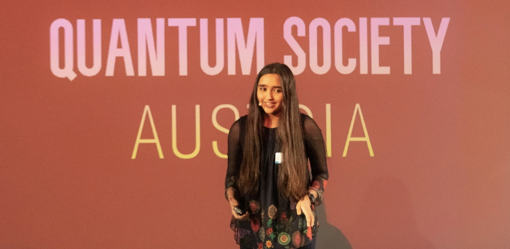
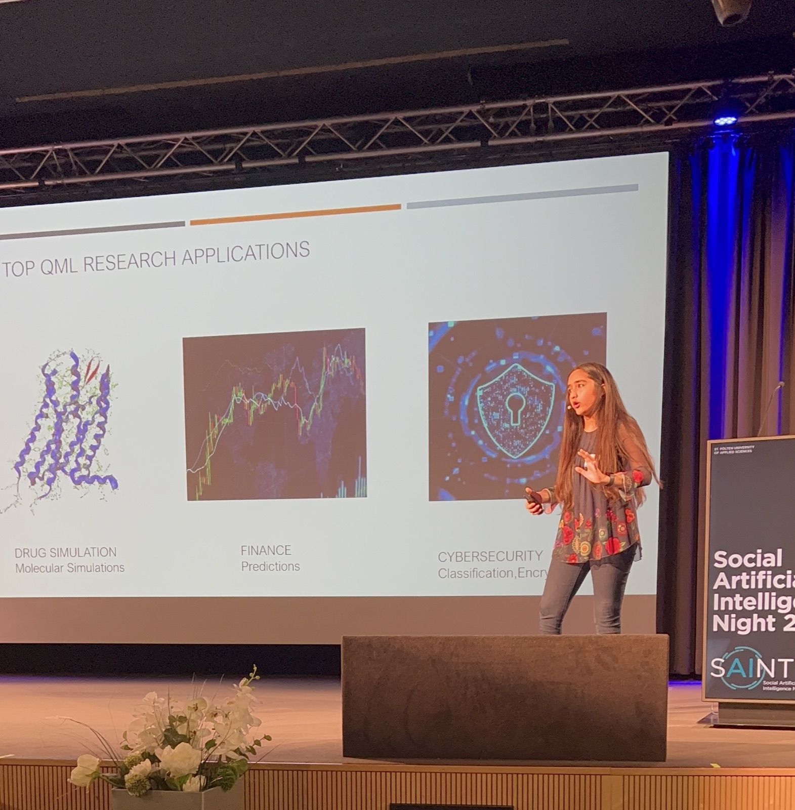
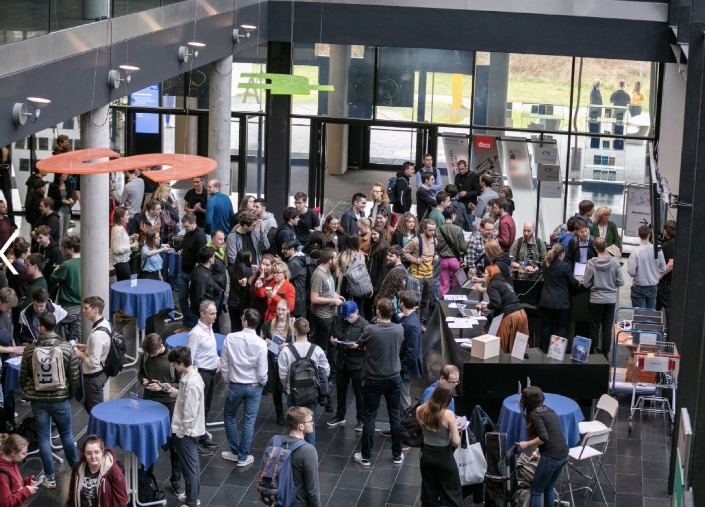

# Social Artificial Intelligence Night at FH St. Pölten

In April 2023, Quantum Society Austria made a significant contribution to the Social Artificial Intelligence Night at FH St. Pölten. They presented on the topic of Quantum Machine Learning (QML), a field with immense potential and wide-ranging applications. The talk focused on how QML could revolutionize sectors such as healthcare, finance, and cybersecurity, sparking interest among the diverse audience of students and industry leaders.

## Quantum Machine Learning: A Future of Possibilities

Quantum Society Austria gave a talk at the Social Artificial Intelligence Night at FH St. Pölten, focusing on the future potential of Quantum Machine Learning (QML). The presentation highlighted the diverse applications of QML, particularly in sectors like healthcare, finance, and cybersecurity. In healthcare, QML could revolutionize diagnostics and treatment planning. In finance, it could optimize trading strategies and risk management. And in cybersecurity, it could enhance threat detection and response times. The potential of QML is vast and continues to be explored.

## Engaging a Diverse Audience

The audience at the event comprised students and industry leaders in artificial intelligence. Their interest in the topic was palpable, reflecting the growing curiosity and recognition of quantum technology's potential in the AI community. The presentation was well-received, with attendees appreciating the insights shared and the potential impact of QML in various applications.

## Link to Event & Special Thanks

Quantum Society Austria extends its gratitude to FH St. Pölten for hosting the event and providing a platform for such engaging discussions. The event was recorded, allowing the insights and discussions to reach a wider audience and inspire more individuals in the field of AI. As we continue to explore and understand quantum technology, events like these play a crucial role in fostering dialogue, collaboration, and innovation in the field. The future of Quantum Machine Learning looks promising, and we look forward to more such engaging discussions.

View the recording of the talk on [YouTube](https://youtu.be/ZWuG_nu3ja8?si=xi4SKCcdHgUHo53i).

## Social Media

View more posts and reactions to this event on [LinkedIn](https://www.linkedin.com/company/quantum-society-austria/) and [Instagram](https://www.instagram.com/quantumsocietyaustria/).
