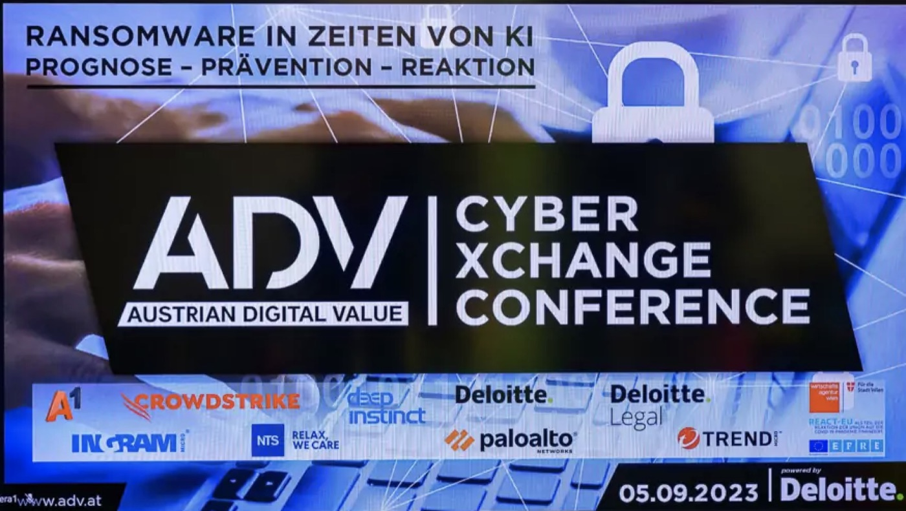
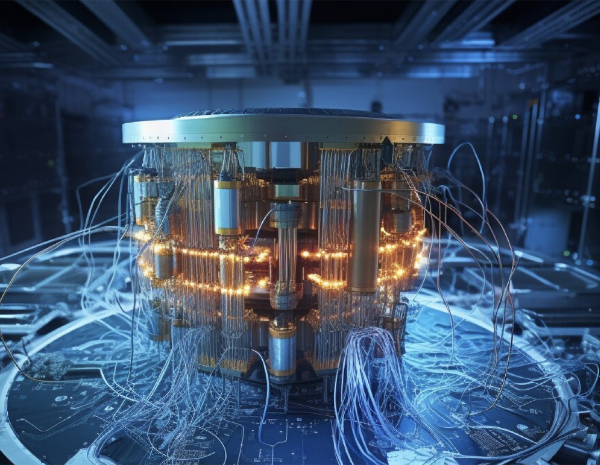
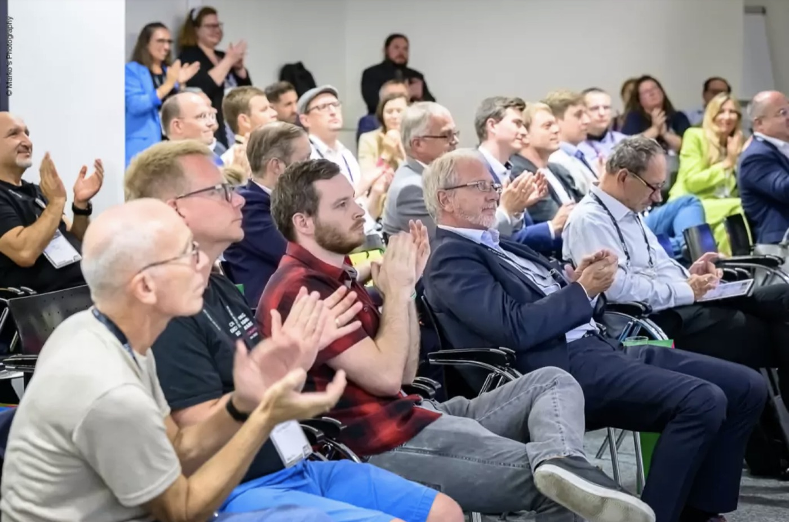
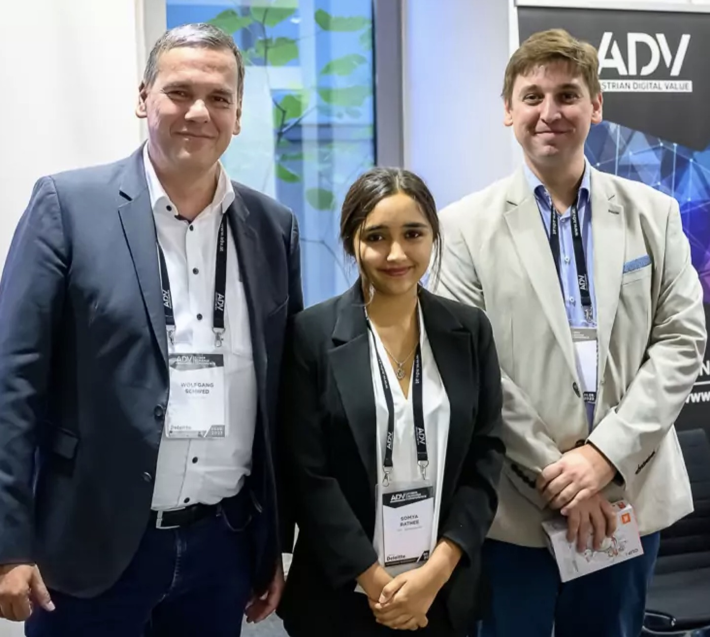

In the rapidly evolving digital landscape, the Austrian Digital Value Conference stands as a beacon of innovation and progress. This event brings together experts from various fields, fostering dialogue and collaboration in the pursuit of digital excellence. One of the highlights of the recent conference was the presentation by Quantum Society Austria. They delved into the fascinating world of Quantum Machine Learning in Cyberspace, sparking interest and curiosity among the attendees. This article provides an overview of the presentation and its impact on the audience, shedding light on the potential of quantum technology in our digital future. Let's delve into the details.

## Quantum Machine Learning in Cyberspace: A Deeper Dive

Quantum Machine Learning (QML) in cyberspace is a burgeoning field that holds immense potential for various applications. One of the key areas where QML can make a significant impact is spam detection. Traditional spam filters often struggle with the dynamic nature of spam emails, which constantly evolve to bypass detection mechanisms. However, QML algorithms, with their ability to process vast amounts of data and identify complex patterns, can significantly improve the accuracy of spam detection.

Hybrid models, which combine classical machine learning techniques with quantum algorithms, are proving to be particularly effective. These models leverage the strengths of both approaches, providing a balance between computational efficiency and predictive power. For instance, a hybrid model might use a classical algorithm for data pre-processing and a quantum algorithm for the actual learning task. This approach allows for the efficient handling of large datasets while still benefiting from the unique advantages of quantum computation.

## Audience Diversity

The event was remarkable for its diverse audience, which included experts from various fields, from economy to cyberspace. This diversity reflects the wide applicability and interest in quantum technology. The presence of such a varied audience highlights the growing recognition of the potential impact of quantum technology across different sectors.

## Event Impact

The Austrian Digital Value Conference provided an excellent platform for Quantum Society Austria to share their insights on Quantum Machine Learning. The interest generated by their presentation indicates a promising future for quantum technology in Austria and beyond. As more experts from various fields engage with this technology, we can anticipate innovative applications and advancements in the near future.

## Social Media

View more posts and reactions to this event on [LinkedIn](https://www.linkedin.com/company/quantum-society-austria/) and [Instagram](https://www.instagram.com/quantumsocietyaustria/), and on the [ADV LinkedIn page](https://www.linkedin.com/company/adv-arbeitsgemeinschaft-datenverarbeitung/).

This post was originally published on [our old website](https://www.quantumsocietyaustria.com/event_adv.html) and has been migrated here.
