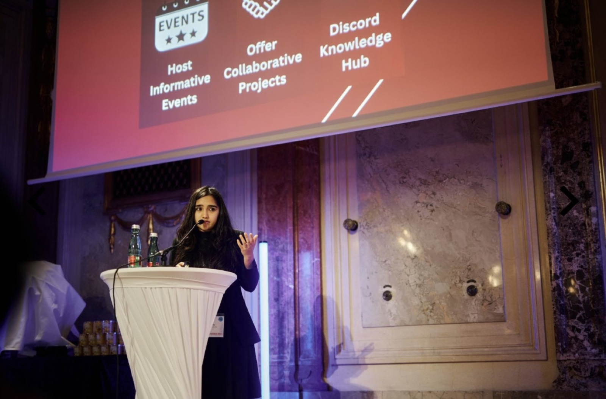
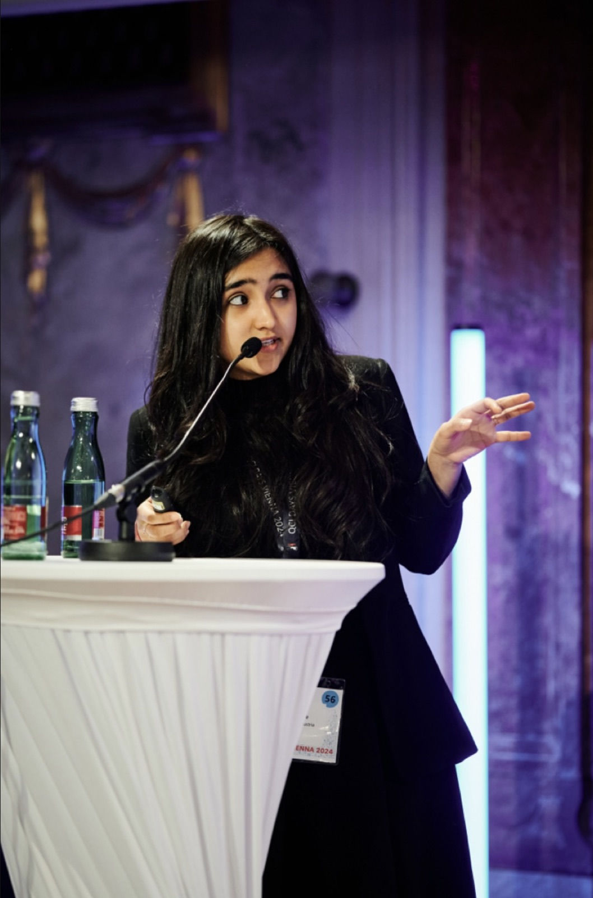
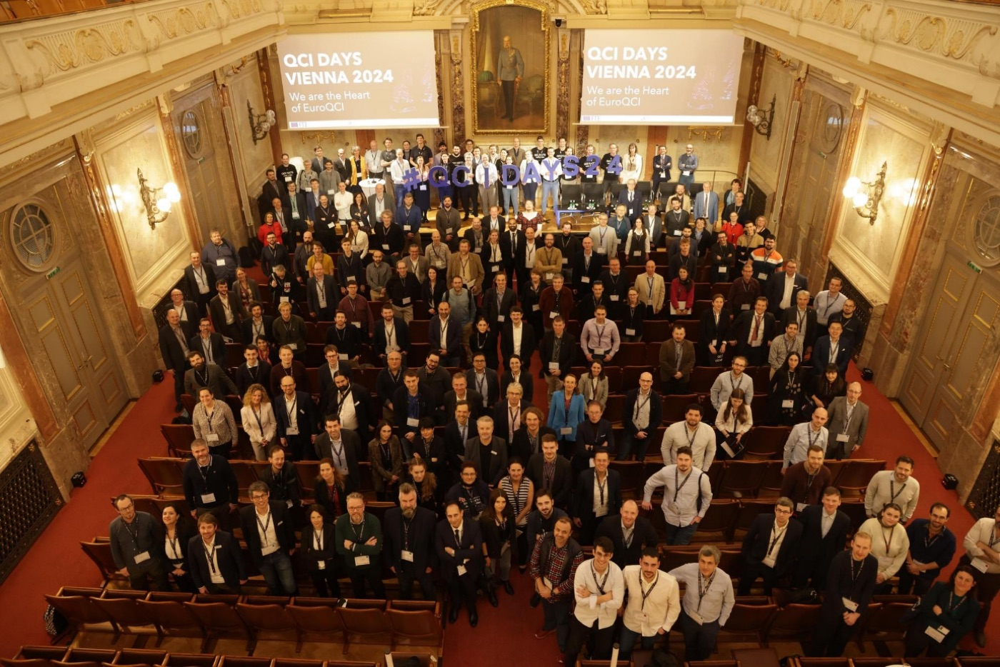
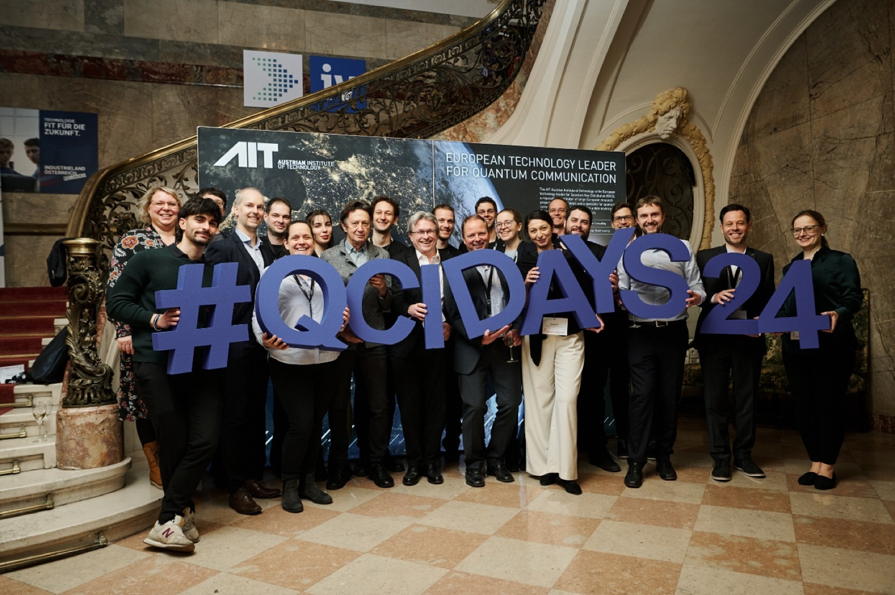

# QCI-CAT: Connecting Quantum Research, Industry, and Society

From January 24th to 26th, QCIDays Vienna 2024 was held at the Federation of Austrian Industries, marking an important milestone in Austria's quantum journey. Organized under the QCI-CAT research project, led by the Austrian Institute of Technology (AIT) and its consortium, the three-day event brought together leading figures from research, startups, academia, and industry. It provided a platform for collaboration, exchange of ideas, and discussions about the future of quantum communication infrastructures in Europe. Quantum Society Austria was proud to participate and contribute to the growing momentum of Austria's quantum ecosystem.

## Representing the Grassroots Quantum Community

Quantum Society Austria attended QCIDays Vienna 2024 to deliver a talk focused on the importance of collaboration between industry and society. The talk emphasized that building strong bridges between companies, researchers, and community-driven initiatives is crucial for inspiring the next generation of quantum scientists and technologists. Greater engagement with grassroots organizations can help open the field to more students, young professionals, and enthusiasts, ensuring that innovation is fueled not just by technical advances but also by widespread public participation.

## Building a Stronger National Quantum Identity

A key highlight of the conference was the collective move toward unifying Austria's quantum organizations, startups, and initiatives under a single national brand. This effort aims to strengthen the international presence of Austrian quantum companies and streamline outreach activities across sectors. A more unified identity will help foster a sense of shared purpose, encourage collaborations between different players, and make Austria's quantum efforts more visible and accessible to society at large.

## Thank You to QCI-CAT and AIT

We are grateful to the Austrian Institute of Technology and the QCI-CAT project for providing a platform where diverse voices from the quantum community could be heard. Events like QCIDays Vienna 2024 are instrumental in breaking down barriers between academia, industry, and society, paving the way for a collaborative, inclusive, and future-ready quantum ecosystem. Quantum Society Austria looks forward to continuing its efforts to connect students, researchers, and industry leaders in shaping the next chapter of quantum innovation.

## Social Media

View more posts and reactions to this event on [LinkedIn](https://www.linkedin.com/feed/update/urn:li:activity:7321908918043983872) and [Instagram](https://www.instagram.com/p/C3V7zoDtgv3/), and on the [QCI-CAT page](https://qci-cat.at/qci-days-event/).
