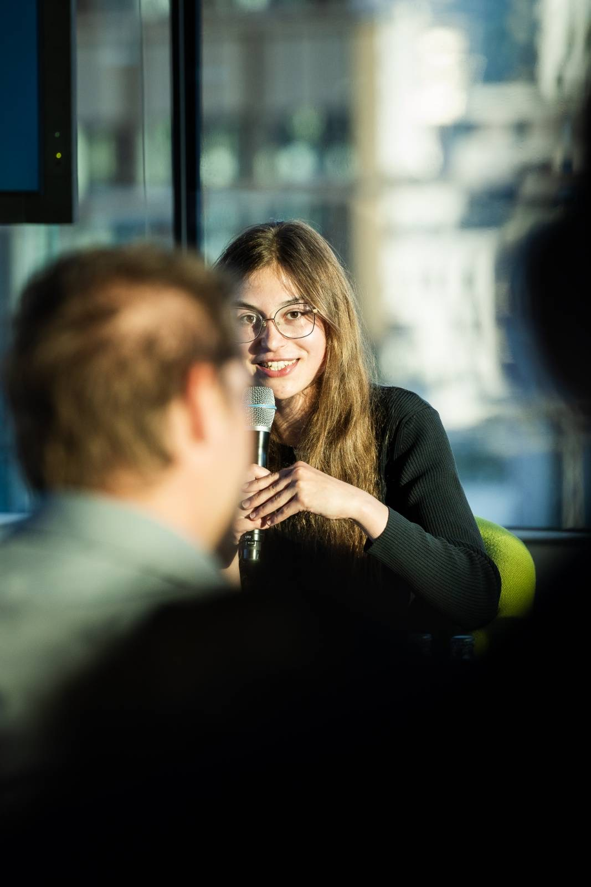
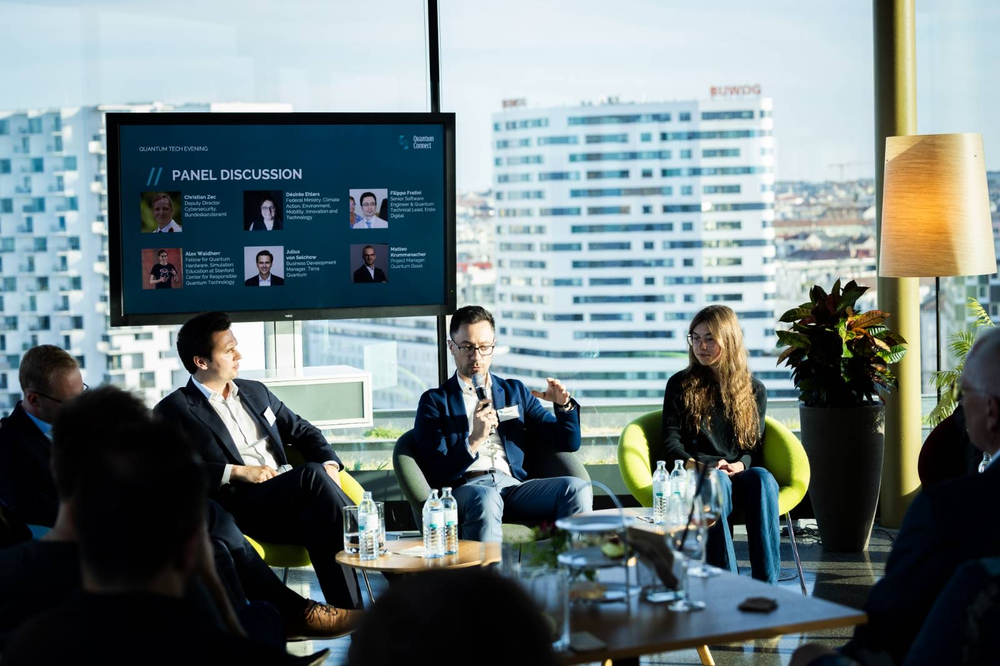
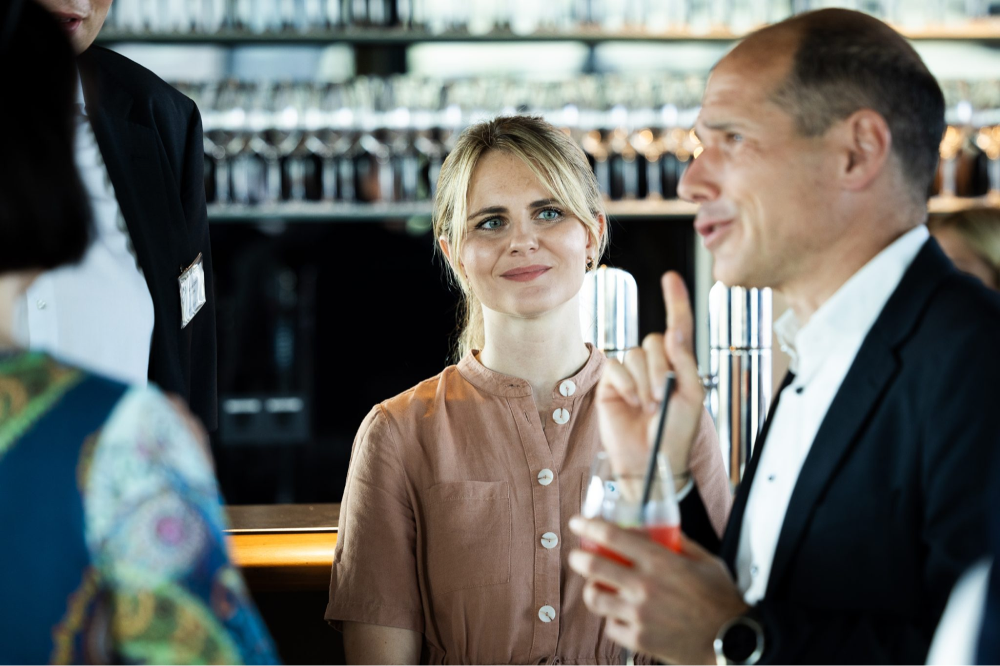
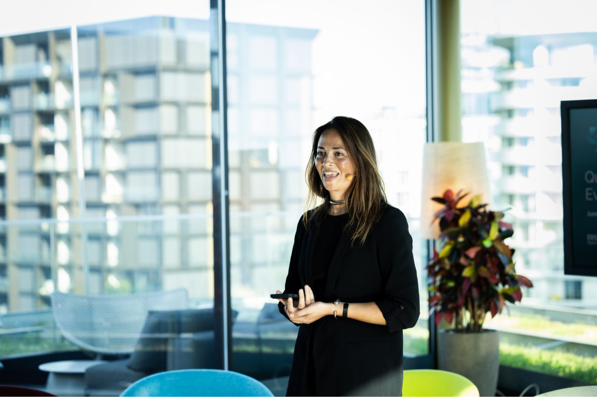

In June 2024, Alex Waldherr from Quantum Society Austria had the honor of participating in the QuantumConnect kickoff event in Vienna!

With over 70 participants from academia, politics, administration, startups, major law firms, industry leaders, publicly funded institutions, and media, the event showed just how much energy and momentum Austria's quantum ecosystem already has. We are proud that our mission to strengthen education, research, and collaboration across all sectors resonated with such a diverse audience.

We want to especially thank the fantastic speakers and panelists who shaped the day with their insights:

- Mira Dechant (Moderator; Chief Marketing Officer, QAI)
- Christoph Helm (CEO, Erste Digital)
- Jona Boeddinghaus (Initiator of QuantumConnect; Managing Director & Co-Founder, Gradient Zero)
- Karim Osman (Lead, QuantumConnect)
- Filippo Fratini (Senior Software Engineer & Quantum Technical Lead, Erste Digital)
- Désirée Ehlers (Quantum Ecosystem Manager, BMK)
- Christian Zec (Deputy Director Cybersecurity, Bundeskanzleramt Österreich)
- Julius von Selchow (Business Development Manager, Terra Quantum AG)
- Alex Waldherr (Quantum Society Austria)
- Matteo Krummenacher (Quantum & AI Analyst, QuantumBasel)

## Representing Education, Research, and Outreach

At QuantumConnect, Alex, from QSA, proudly represented the educational and academic perspective within Austria's growing quantum ecosystem. Throughout the event, she contributed to discussions around quantum security, quantum algorithms, and — very importantly — the broader landscape of quantum technologies beyond just computing. She helped clarify key areas such as sensors, cryptography, networks, simulators, and the distinction between hardware- and software-focused technologies. During the discussions, Alex placed a special emphasis on **education, research funding, and clear knowledge transfer**. Whenever complex topics like "quantum annealing" came up, she made it a priority to explain them accessibly to the audience. Alex also led deeper conversations around different quantum computer backend architectures, ensuring that even non-specialists could engage with the technical topics.

## Austria's International Future in Quantum

A major topic toward the end of the event was Austria's role on the international stage — especially in political and ethical discussions around quantum technologies. Here, we emphasized that academic strength must remain the foundation of Austria's strategy: by building a base of world-class, reliable research data, Austria can position itself confidently for future political leadership. Sometimes, as we shared from international examples like Stanford, staying "under the radar" while focusing on excellent academic work can be the smartest long-term move. And Austria is already incredibly strong academically — a fact we should recognize and continue to build on with pride! We are excited to continue working with initiatives like QuantumConnect and look forward to many more events where we can represent education, students, and the next generation of quantum leaders. 🚀

## Social Media

View more posts and reactions to this event on [LinkedIn](https://www.linkedin.com/feed/update/urn:li:activity:7322901299811762177) and [Instagram](https://www.instagram.com/p/DJKMaiiMT85/).
