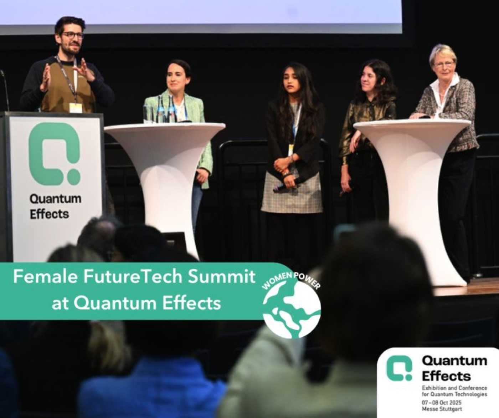
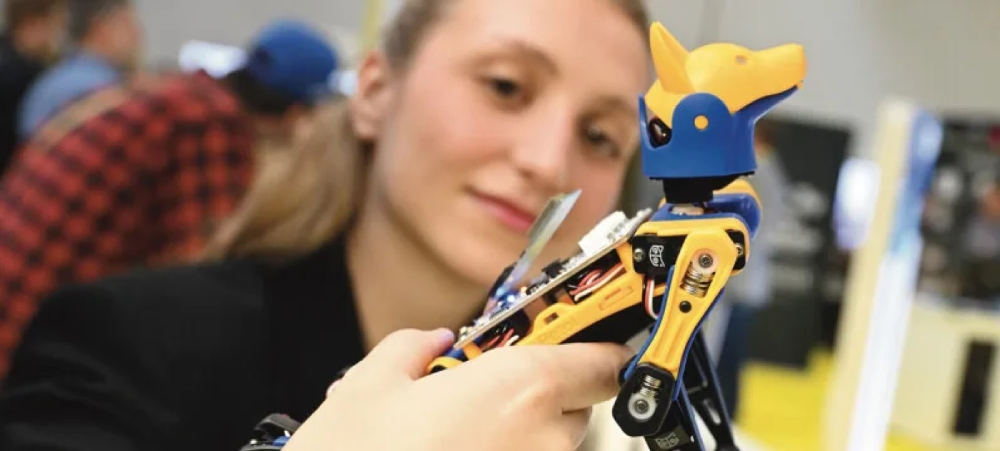

Somya Rathee recently attended the Quantum Effects event in Stuttgart, where she participated in a panel discussion titled "Let's get (Quantum) Physical! How Quantum Tech is Empowering Diverse Leadership and Workforce," moderated by Dr. Stefan Seegerer. She was joined by esteemed panelists: Esperanza Cuenca Gómez, Developer Relations Manager for Quantum Computing at NVIDIA; Dr. Marta Pascual Estarellas, CEO of Qilimanjaro Quantum Tech; and Dr. Katrin Kobe, CEO of Bosch Quantum Sensing. Together, they discussed how to build a more inclusive and diverse leadership environment within the quantum computing field.

## Making Quantum Education Accessible to All

At the Quantum Effects event, Somya Rathee emphasized the importance of expanding access to quantum education. Although quantum technologies are advancing rapidly, public understanding remains limited, creating a major obstacle to wider acceptance. Bridging this knowledge gap requires targeted communication strategies and proactive educational initiatives. Key approaches include offering scholarships and financial aid to students from underrepresented groups, establishing mentorship programs to connect seasoned professionals with diverse newcomers, and organizing outreach efforts in schools, universities, and community centers. Programs like the Quantum Social Lab in Munich serve as inspiring models for raising awareness and sparking interest in quantum technologies across all demographics.

## Teaching What Quantum Computing Is — and What It Isn't

Somya also highlighted the need to teach not just what quantum computing can do, but what it cannot. Public discussions often paint quantum computing as an all-powerful solution, but it's crucial to set realistic expectations. Quantum computers are not designed to make every computation faster; they excel only at specific types of problems. Moreover, the technology is still in its infancy, grappling with challenges like noise, instability, and error correction. It's equally important to stress that quantum computers will not replace classical computers — instead, they will complement them, solving specialized tasks that classical systems cannot efficiently handle. Clear communication about these realities is vital for building an informed and responsible community around quantum technology.

## Encouraging More Women to Enter the Quantum Field

A recurring theme in the panel was the encouraging growth of women entering the quantum industry, a trend that is outpacing other technical sectors, as noted by Dr. Katrin Kobe. However, Somya Rathee and fellow panelists agreed that success in quantum requires more than representation; it demands resilience, adaptability, and the courage to fail. As Dr. Marta Pascual Estarellas pointed out, the quantum field is evolving at a rapid pace, making it essential for professionals to embrace challenges, learn from their mistakes, and continuously update their skills. True progress will come not just from increasing diversity in numbers, but from fostering a culture that values continuous learning, flexibility, and perseverance.

This post was originally published on [our old website](https://www.quantumsocietyaustria.com/event_QuantumEffectsStuttgart.html) and has been migrated here.
